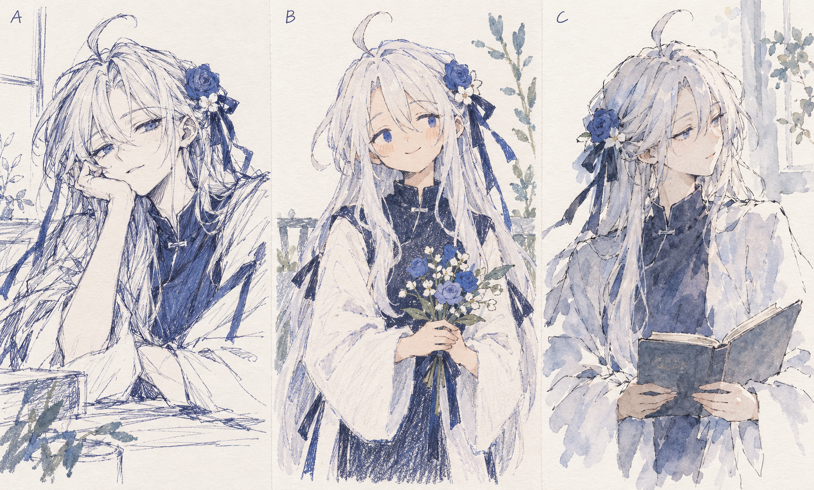
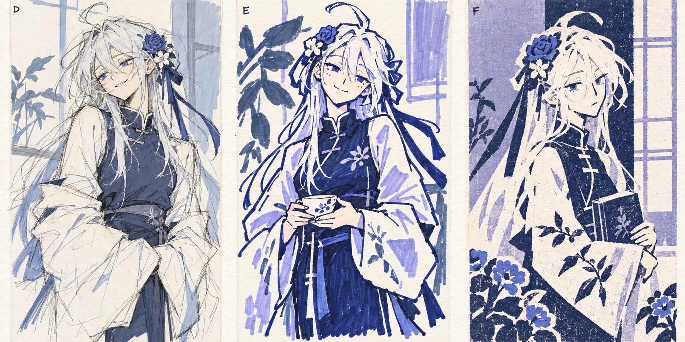

# P8 人物风格候选，等待用户挑选

更新：用户已上传B裁图并选定B，要求“多来点类似的”。同系列四幅新场景已生成并实际展示，见assets/scenes/b-series/README.md；不再等待A-F选择，下文保留为六种候选产生时的历史记录。

2026-10-19。用户在完整精细插画和后续彩铅候选后继续要求：“人物要减少AI味，多去尝试其他风格”“多生成一些，我挑一个最符合需求的”。因此暂不实施P8或重做P6包，先展示六种人物画法供选择，不由代理自行定稿。

两张候选板由imagegen分别新绘，没有把同一精细人物简单叠纸纹。六项保持白发/发束、蓝花白花、深蓝缎带、中式领口和蓝紫色身份，在五官、形状、线条、色块上做差异。不同姿态只为风格比较，选定后统一整套构图与姿态。候选图是源码参考，不加入package.files、不当发布资源。

| 编号 | 方向 | 观察 |
| --- | --- | --- |
| A | 蓝色钢笔漫画速写 | 寻线/排线较多，半睁眼、略带慵懒和小表情 |
| B | 彩铅绘本 | 简化圆润五官、平涂、柔和亲切 |
| C | 钢笔淡水彩 | 断线、渗色、克制五官与留白 |
| D | 动画草稿 | 结构草线、轻色块、偏随性的人物比例和神态 |
| E | 粗记号笔涂鸦 | 粗细不匀笔触、简化面部、强蓝紫色块，手绘感更直接 |
| F | 套色版画 | 靛蓝/淡紫套印、纸面形状与较强轮廓 |

源图原件保留在Codex generated_images，不删除；项目副本仅复制，未裁切/重绘。两板都已经实际目视查看，A/D更偏速写，E更偏粗线涂鸦。用户可回复单个编号或组合偏好；下一步按选择重新画宽幅主场景、竖幅辅助场景，再接真实DSH UI，不直接把三联候选板当背景。

首轮精细月色花房和“精细人物+彩铅纸纹”的候选未获采用，保留为本地未选草稿；不打包，不称其已满足最新需求。P7 f96f68f只是可回退技术基线。安装文档与package preview.2仍未完成，不交付旧包。
